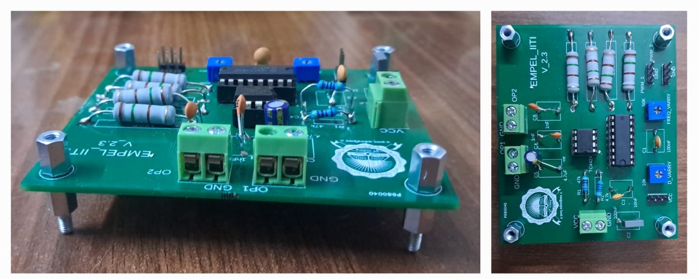
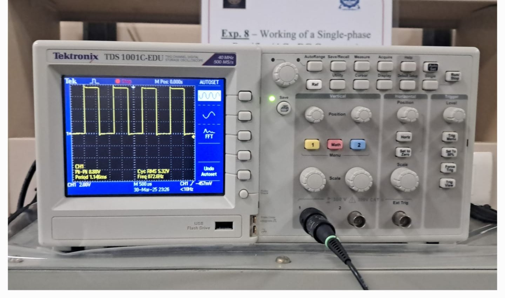
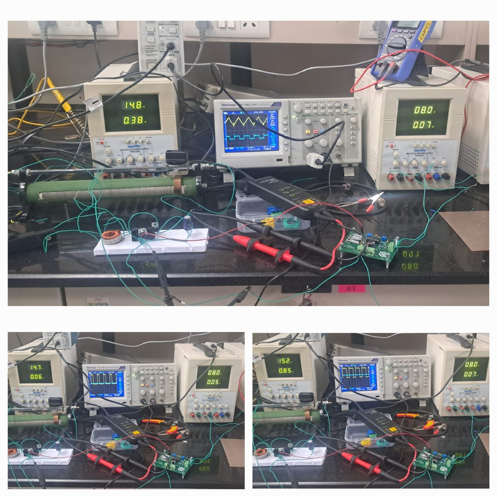
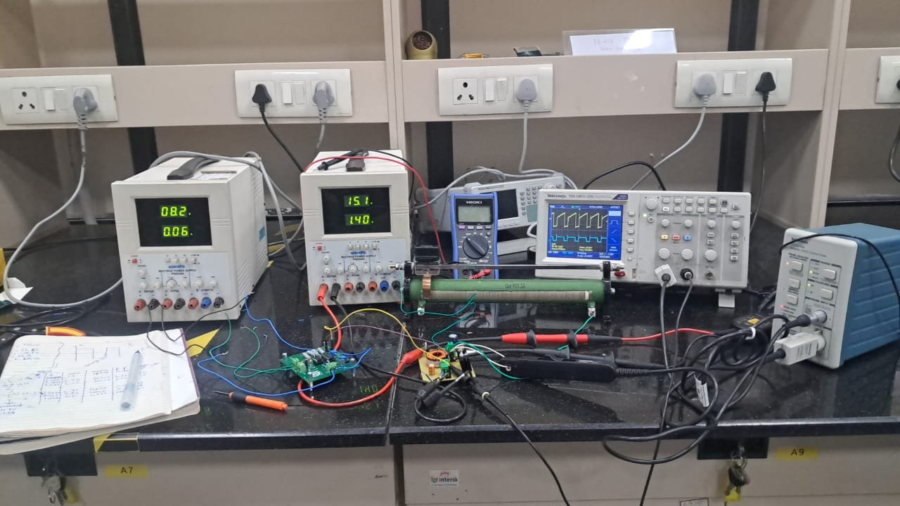

# Buck-Boost Converter: Design, Simulation & PCB Fabrication

> End-to-end realization of a non-isolated **inverting buck-boost DC-DC converter**: a custom MOSFET gate-driver (PWM generator), a breadboard prototype, a fabricated PCB, MATLAB Simulink modelling, and experimental validation in CCM and DCM.


---

## Overview

This project covers the full development cycle of a buck-boost converter, from soldering the gate-driver board to validating a custom-fabricated converter PCB against theoretical and simulated results.

**Highlights**
- Soldered and tested a PWM gate-driver board with independently adjustable **duty cycle** and **frequency**.
- Built and debugged a buck-boost power stage on a breadboard, observing **inductor voltage** (differential probe) and **switch current** (current probe).
- Demonstrated **Discontinuous Conduction Mode (DCM)** by lowering the switching frequency.
- Designed the converter PCB in **EasyEDA** and fabricated it at the **Makerspace Lab, IIT Indore**.
- Validated output voltage for four duty cycles (39.5 % – 61.7 %) against theory and a MATLAB Simulink model.

---

## Theory

For an ideal inverting buck-boost converter in CCM:

```
Vo = − Vg · D / (1 − D)
```

| Duty cycle (D) | Behaviour |
|:---:|---|
| D < 0.5 | Step-down (buck) magnitude |
| D = 0.5 | \|Vo\| = Vg |
| D > 0.5 | Step-up (boost) magnitude |

The output polarity is **inverted** relative to the input. Lowering the switching frequency (or load current) lets the inductor current reach zero within each cycle, which puts the converter in **DCM**.

---

## Project Workflow

```
Gate-driver PCB  →  Breadboard prototype  →  Converter PCB design  →  Fabrication  →  Testing & comparison
   (soldering)       (CCM / DCM check)         (EasyEDA)           (Makerspace IITI)   (Simulink vs. hardware)
```

---

## Stage 1 – Gate Driver (Square-Wave Generator)

**Aim:** Solder the provided PCB and components to build a pulse-wave generator (gate-driver circuit) for the MOSFET.




**Key points**
- Supplies the gate signal to the MOSFET of the main power circuit.
- Two potentiometers tune the output:
  - `D_VARRY` → duty cycle
  - `FREQ_VARRY` → frequency
- `PWM_2` output is identical to `OP2`.
- Output verified on a Tektronix TDS 1001C-EDU oscilloscope.

**Precautions / possible failure causes**
- Inspect both ICs carefully before use.
- If an IC heats up, re-check all connections and solder joints.
- Test the potentiometers before powering the board.

---

## Stage 2 – Breadboard Prototype

**Aim:** Construct a buck-boost circuit on a breadboard to validate the topology before moving to PCB.



**Key points**
- The gate-driver board generated the switching pulses; the **MOSFET drain terminal** served as the common ground.
- **Inductor voltage** was measured with a differential probe: waveform matched expectations.
- **Switch current** was measured with a current probe: waveform matched expectations.
- Reducing the switching frequency successfully produced **DCM** operation.

---

## Stage 3 – PCB Design & Fabrication

**Aim:** Design, build, and test a buck-boost converter PCB driven by the gate-driver.

**Design decisions**
- Adequate board area reserved for the **MOSFET heatsink**.
- **Inductor voltage:** differential probe placed across header pins **H3** (supply potential) and **H4** (drain voltage).
- **Switch current:** a jumper wire from **pin 3 to pin 2 of H4** puts a current-probe loop in series with the switch, so the measured current equals the switch current.

---

## Experimental Results

### Test setup



### Part A – Output voltage vs. duty cycle

Fixed input voltage (**15.1 V**) and load resistance; duty cycle varied. Inductor voltage and switch current were also recorded for each point.

| Duty cycle (%) | Frequency (kHz) | Vpp (V) | Vin (V) | Vo observed (V) | Vo expected (V) | % error |
|:---:|:---:|:---:|:---:|:---:|:---:|:---:|
| 39.5 | 7.407 | 10.2 | 15.1 | −8.72  | −9.86  | 11.56 |
| 49.7 | 7.082 | 10.4 | 15.1 | −13.0  | −14.92 | 12.86 |
| 55.4 | 7.212 | 10.2 | 15.1 | −16.2  | −18.76 | 13.65 * |
| 61.7 | 7.226 | 10.2 | 15.1 | −20.0  | −24.32 | 17.76 |

\* Recomputed from the tabulated values: (18.76 − 16.2) / 18.76 = 13.65 %. The original lab report listed 15.78 %, which does not match its own voltages; verify against your raw data.

**Observations**
- Observed output is consistently lower in magnitude than the ideal prediction, and the gap widens as duty cycle increases.
- This is expected from non-idealities not included in the ideal equation: inductor winding resistance, MOSFET on-resistance, diode forward drop, and switching losses. These losses matter more at high duty cycle, where inductor current is larger.

### Part B – Discontinuous Conduction Mode (DCM)

DCM was demonstrated by lowering the gate-pulse frequency while keeping the other parameters fixed.

---

## Tools & Equipment

| Category | Details |
|---|---|
| Simulation | MATLAB Simulink |
| PCB design | EasyEDA |
| Fabrication | Makerspace Lab, IIT Indore |
| Instruments | Tektronix TDS 1001C-EDU oscilloscope, differential probe, current probe, DC power supplies, multimeter, rheostat load |

---

## Key Learnings

- Practical operation of a buck-boost converter beyond ideal equations.
- Effect of non-ideal components on voltage gain and efficiency.
- Transition between CCM and DCM and how to identify each from waveforms.
- Measurement technique: differential and current probing in a switching circuit.
- Complete PCB workflow: schematic, layout, fabrication, soldering, debugging.
- Importance of bridging simulation with real hardware.

